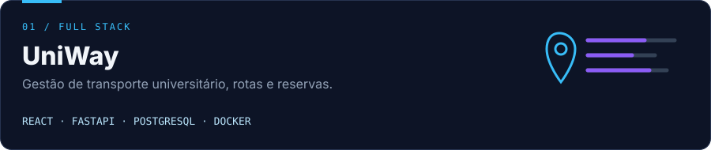
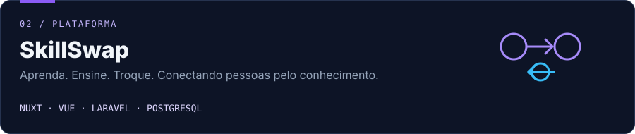
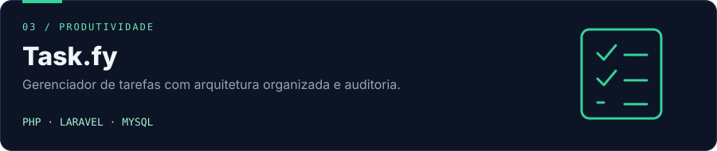
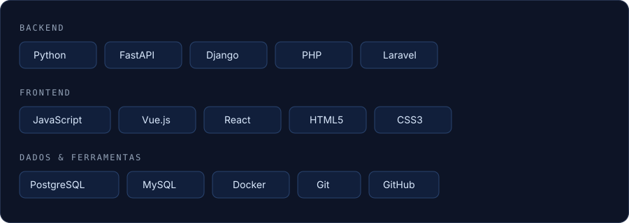
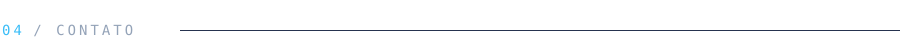

  

  
  
  

  

---

  

## 

  
  
  

  Projetos selecionados — clique nos cards para ver o código e a documentação. <a href="https://github.com/geancarlos-brito?tab=repositories">Ver todos os repositórios →</a>

## 

  

## 

- **Arquitetura de software** — organização de projetos e boas práticas
- **APIs REST** — desenvolvimento e integração entre aplicações
- **Dados** — modelagem, PostgreSQL e persistência
- **Qualidade e entrega** — testes automatizados, Git, GitHub e Docker

## 

  
  

  <picture>
    <source media="(prefers-color-scheme: dark)" srcset="https://raw.githubusercontent.com/geancarlos-brito/geancarlos-brito/output/github-contribution-grid-snake-dark.svg"/>
    <source media="(prefers-color-scheme: light)" srcset="https://raw.githubusercontent.com/geancarlos-brito/geancarlos-brito/output/github-contribution-grid-snake.svg"/>
    
  </picture>

  Gráfico de contribuições atualizado automaticamente todos os dias.

## 

  <strong>Vamos trocar ideias e construir coisas legais.</strong> 
  <a href="https://www.linkedin.com/in/gean-carlos-rocha-brito-a3a421352/">LinkedIn</a> ·
  <a href="mailto:grochabrito@gmail.com">E-mail</a> ·
  <a href="https://github.com/geancarlos-brito?tab=repositories">Repositórios</a>

  Aprender. Construir. Compartilhar. Evoluir.

