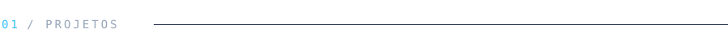
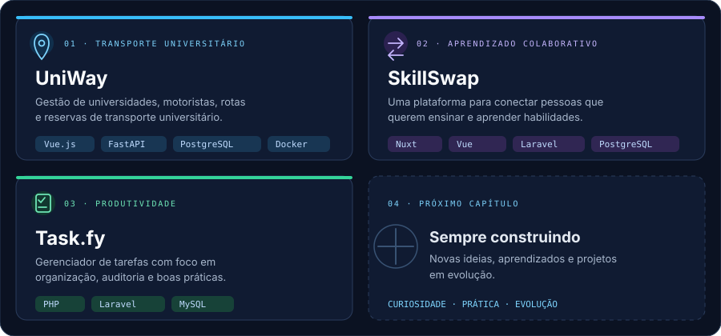
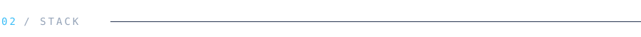
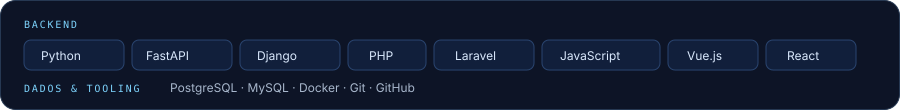
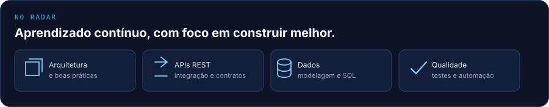
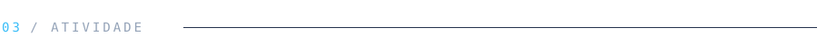
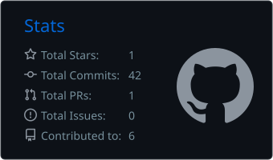
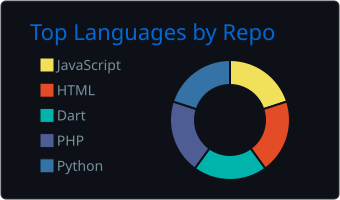

  

  
  
  

  

---

  

## 

  

  <a href="https://github.com/geancarlos-brito/UniWay">UniWay</a> ·
  <a href="https://github.com/geancarlos-brito/skillswap">SkillSwap</a> ·
  <a href="https://github.com/geancarlos-brito/Taskfy-PHP">Task.fy</a> ·
  <a href="https://github.com/geancarlos-brito?tab=repositories">Todos os projetos</a>

## 

  

  
  
  
  
  
  
  
  
  
  
  
  
  

## 

  

## 

  
  

  <picture>
    <source media="(prefers-color-scheme: dark)" srcset="https://raw.githubusercontent.com/geancarlos-brito/geancarlos-brito/output/github-contribution-grid-snake-dark.svg"/>
    <source media="(prefers-color-scheme: light)" srcset="https://raw.githubusercontent.com/geancarlos-brito/geancarlos-brito/output/github-contribution-grid-snake.svg"/>
    
  </picture>

  Gráfico de contribuições atualizado automaticamente todos os dias.

## 

  <strong>Vamos trocar ideias e construir coisas legais.</strong> 
  <a href="https://www.linkedin.com/in/gean-carlos-rocha-brito-a3a421352/">LinkedIn</a> ·
  <a href="mailto:grochabrito@gmail.com">E-mail</a> ·
  <a href="https://github.com/geancarlos-brito?tab=repositories">Repositórios</a>

  Aprender. Construir. Compartilhar. Evoluir.

